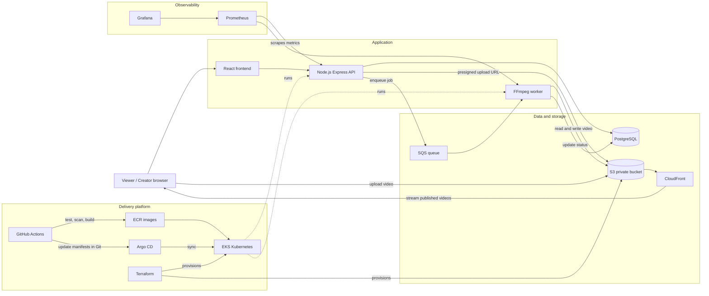

# StreamSphere Architecture

Target architecture. Components are introduced phase by phase, starting with the local version.

## Build order

1. Local: React, Express, PostgreSQL, local file storage, worker.
2. Docker Compose for all services.
3. CI/CD and security scanning.
4. AWS via Terraform: S3, ECR, RDS, SQS, CloudFront, EKS.
5. Helm, Argo CD, monitoring.